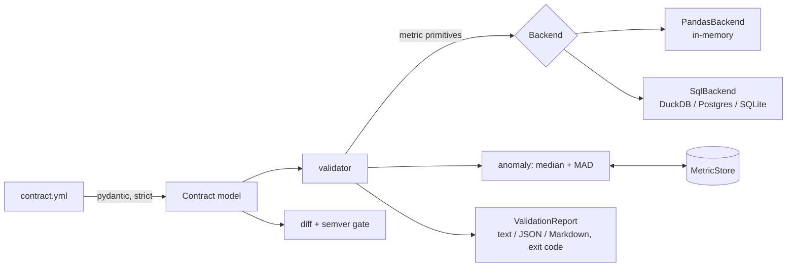

# dq-contracts

[](https://github.com/CodeWithSubramani/dq-contracts/actions/workflows/ci.yml)


**Declarative, versioned data contracts for pipelines** — validate datasets with SQL pushdown,
catch volume anomalies with robust statistics, and block breaking schema changes in CI with
semver enforcement.

Most data incidents aren't "bad code"; they're an **unannounced change at a boundary**: a producer
adds an enum value, relaxes a `NOT NULL`, renames a column, or ships half a day's data. This library
makes that boundary explicit and machine-checked on both sides:

| Where | What runs | Catches |
|---|---|---|
| **Producer PR** | `dq-contracts diff old.yml new.yml` | Breaking change shipped without a MAJOR bump |
| **Pipeline run** | `validate(contract, backend)` | Nulls, dupes, enum/range/regex violations, stale or missing data |
| **Over time** | Metric store + robust z-score | Silent volume drops a static threshold would miss |

## Quick start

```bash
pip install -e ".[dev]"

# Validate a file (exit code 1 => blocking failures)
dq-contracts validate examples/contracts/orders.v1.yml --data examples/orders.csv

# Validate a warehouse table with pushdown (no rows leave the DB)
dq-contracts validate examples/contracts/orders.v1.yml --duckdb warehouse.duckdb --table analytics.orders \
  --history metrics.jsonl --format markdown

# Gate a contract change in CI
dq-contracts diff examples/contracts/orders.v1.yml examples/contracts/orders.v2.yml
#   breaking  status               new allowed values ['refunded']
#   additive  coupon_code          column added
#   FAIL: breaking change requires a MAJOR bump (got 1.0.0 -> 1.1.0)
```

```python
from dq_contracts import Contract, MetricStore, validate
from dq_contracts.backends import SqlBackend
import duckdb

report = validate(
    Contract.from_yaml("contracts/orders.yml"),
    SqlBackend(duckdb.connect("warehouse.duckdb"), "analytics.orders", dialect="duckdb"),
    metric_store=MetricStore("metrics.jsonl"),
)
if not report.passed:
    raise RuntimeError(report.to_text())   # fail the Airflow task / dbt run-operation
```

## A contract

```yaml
dataset: orders
version: 1.0.0
owner: commerce-data@company.example
primary_key: [order_id]
columns:
  - { name: order_id, type: string, nullable: false, pattern: "ord_[0-9a-f]{8}" }
  - { name: status,   type: string, nullable: false,
      allowed_values: [placed, paid, shipped, delivered, cancelled] }
  - { name: amount,   type: float,  nullable: false, min: 0, max: 100000 }
  - { name: email,    type: string, pii: true }
  - { name: updated_at, type: timestamp, nullable: false }
freshness: { column: updated_at, max_age_hours: 6 }
volume:    { min_rows: 1, anomaly_threshold: 3.5, min_history: 7 }   # warn-level by default
checks:
  - name: delivered_orders_have_amount
    sql: "SELECT COUNT(*) FROM {table} WHERE status = 'delivered' AND amount <= 0"
```

## Architecture



## Design decisions

- **Backends implement metric primitives, not rules.** A backend only answers questions like
  `null_count(col)` or `duplicate_count(cols)`; the validator composes them into checks. Adding Spark
  or Snowflake is ~10 small methods, and every rule works on every engine (the test suite runs the same
  assertions against pandas and SQL).
- **Pushdown by default.** `SqlBackend` issues one aggregate query per metric, so validating a large
  table costs a few scans, not a data transfer. Identifiers are validated and values are bound
  parameters — contracts are config, but config is still input.
- **A broken check is never a silent pass.** Any engine exception becomes an `ERROR` result that blocks
  (for `error` severity) instead of crashing the run or quietly succeeding.
- **Severity is a first-class field.** Schema and integrity rules default to `error` (stop the
  pipeline); volume defaults to `warn` (page a human, don't halt) because volume shifts are often
  legitimate (sales, holidays, backfills).
- **Robust z-score, not mean/stddev.** One bad backfill day inflates a stddev and hides the next
  incident; median + MAD (scaled by 1.4826) is resistant to that. Flat histories fall back to a 5%
  relative tolerance instead of dividing by zero. A warm-up period avoids alerting on day one.
- **Consumer-centric semver.** New enum values and newly-nullable columns are **breaking** (they break
  exhaustive `CASE` logic and `NOT NULL` assumptions); integer→float and adding a nullable column are
  additive; tightening is a patch. The gate forces the "who consumes this?" conversation *before*
  merge rather than during an incident.
- **Undeclared columns warn, don't fail.** They usually signal a schema change in flight, which is worth
  surfacing without blocking a producer who hasn't updated the contract yet.

## Project layout

```
src/dq_contracts/
  contract.py      # strict pydantic model + static validation (refs, regex, semver, ranges)
  validator.py     # contract -> checks -> ValidationReport
  backends/        # base protocol, pandas, SQL (duckdb | postgres | sqlite dialects)
  anomaly.py       # robust z-score + JSONL metric store
  diff.py          # change classification + semver gate
  results.py       # CheckResult / ValidationReport renderers
  cli.py           # validate | diff | lint
tests/             # same assertions across backends; evolution rules; CLI
examples/          # orders contract v1/v2 + sample CSV
```

## Roadmap

- Spark backend (DataFrame aggregates in a single pass with `agg` over all metrics)
- Partition-scoped validation (`WHERE ds = :ds`) for incremental tables
- OpenLineage facet emission so results show up next to lineage
- Publish metrics to a warehouse table instead of JSONL

## License

MIT
